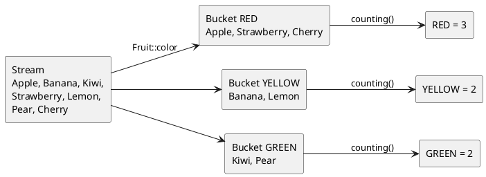

## One example for the whole unit

In the last unit you used downstream collectors such as `counting()` and `mapping(...)`. This unit looks inside: what exactly happens with each group, and why the results have the types they have. All examples use the same seven fruits, **in this order**:

```java
enum Color { RED, YELLOW, GREEN }

record Fruit(String name, Color color, int grams) { }

List<Fruit> basket = List.of(
    new Fruit("Apple", Color.RED, 180),
    new Fruit("Banana", Color.YELLOW, 120),
    new Fruit("Kiwi", Color.GREEN, 75),
    new Fruit("Strawberry", Color.RED, 20),
    new Fruit("Lemon", Color.YELLOW, 90),
    new Fruit("Pear", Color.GREEN, 170),
    new Fruit("Cherry", Color.RED, 10)
);
```

## groupingBy works in two steps

```java
Map<Color, Long> countByColor = basket.stream()
    .collect(Collectors.groupingBy(Fruit::color, Collectors.counting()));
// {RED=3, YELLOW=2, GREEN=2}
```



1. The **classifier** (`Fruit::color`) answers "which bucket?" for every element. Its result becomes the **key** of the map. Inside a bucket, the elements keep their stream order.
2. The **downstream collector** (`counting()`) decides what each bucket turns into. Its result becomes the **value** of the map.

The important detail: every bucket gets its **own, fresh** downstream collector, and that collector only ever sees the elements of its own bucket. The counter of the RED bucket knows nothing about the yellow fruits.

Without a second argument, Java uses `toList()` as downstream: `groupingBy(Fruit::color)` is the same as `groupingBy(Fruit::color, Collectors.toList())`.

## Every collector is a recipe in three steps

A collector, no matter which one, is built from three steps:

1. **Start:** create an empty "memory" for the bucket, for example the number `0` or an empty list.
2. **Add:** called once for every element of the bucket, updates the memory.
3. **Finish:** when the bucket is done, turn the memory into the final value.

This is what happens in the RED bucket (Apple 180 g, Strawberry 20 g, Cherry 10 g) for different downstream collectors (`grams` is short for `Fruit::grams`, and A, S, C for the three fruits):

| Downstream | Start | + Apple | + Strawberry | + Cherry | Finish |
|---|---|---|---|---|---|
| `counting()` | `0` | `1` | `2` | `3` | `3L` |
| `summingInt(grams)` | `0` | `180` | `200` | `210` | `210` |
| `averagingInt(grams)` | sum `0`, count `0` | `180`, `1` | `200`, `2` | `210`, `3` | `210 / 3` = `70.0` |
| `maxBy(grams)` | nothing yet | Apple | Apple (heavier) | Apple | `Optional[Apple]` |
| `toList()` | `[]` | `[A]` | `[A, S]` | `[A, S, C]` | `[A, S, C]` |

The YELLOW and GREEN buckets run the same recipe again **from the start**, each with its own memory.

This also explains two result types that surprise many people:

- **Why `Long`?** Inside the JDK, `counting()` is literally `summingLong(e -> 1L)`: every element adds `1` to a `long`. So the map is a `Map<Color, Long>`, and `Map<Color, Integer>` does not compile.
- **Why `Optional`?** `maxBy` and `minBy` start with *nothing*. A collector must also work on an empty stream, and "the biggest element of nothing" does not exist. So the result is an `Optional<Fruit>`, even though a bucket of `groupingBy` is never empty.

## The type rule

The result of `groupingBy(classifier, downstream)` is always a `Map<K, V>`, where `K` is the result type of the **classifier** and `V` is the result type of the **downstream collector**. With `Fruit::color` as classifier, `K` is `Color`, and `V` depends on the downstream:

| Downstream | Value type | RED bucket |
|---|---|---|
| `toList()` | `List<Fruit>` | `[Apple, Strawberry, Cherry]` |
| `counting()` | `Long` | `3` |
| `summingInt(Fruit::grams)` | `Integer` | `210` |
| `averagingInt(Fruit::grams)` | `Double` | `70.0` |
| `maxBy(comparingInt(Fruit::grams))` | `Optional<Fruit>` | `Optional[Apple]` |
| `mapping(Fruit::name, joining(", "))` | `String` | `"Apple, Strawberry, Cherry"` |
| `summarizingInt(Fruit::grams)` | `IntSummaryStatistics` | count 3, sum 210, min 10, max 180, average 70.0 |

(`comparingInt` is `Comparator.comparingInt`.)

## summarizingInt: five numbers in one go

Often you need several numbers per group at once, for example the lightest, the heaviest **and** the average weight per color. With the collectors above, that would be three separate `groupingBy` calls, each walking through the whole stream. `summarizingInt` computes all of them in **one** pass:

```java
Map<Color, IntSummaryStatistics> statsByColor = basket.stream()
    .collect(Collectors.groupingBy(
        Fruit::color,
        Collectors.summarizingInt(Fruit::grams)
    ));

IntSummaryStatistics red = statsByColor.get(Color.RED);
red.getCount();     // 3      (long)
red.getSum();       // 210    (long)
red.getMin();       // 10     (int)
red.getMax();       // 180    (int)
red.getAverage();   // 70.0   (double)
```

It follows the same recipe as every other collector. The memory is an `IntSummaryStatistics` object that starts with count `0` and sum `0`. Each element updates all five values at once, and the finished object is the value of the map. You read the numbers with the getters.

`summarizingInt` also works without `groupingBy`, for the whole stream:

```java
IntSummaryStatistics all = basket.stream()
    .collect(Collectors.summarizingInt(Fruit::grams));
all.getAverage();   // 95.0  (665 g / 7 fruits)

// the same with a primitive stream:
IntSummaryStatistics all2 = basket.stream().mapToInt(Fruit::grams).summaryStatistics();
```

There are three variants, depending on the type of the number you extract: `summarizingInt` gives `IntSummaryStatistics`, `summarizingLong` gives `LongSummaryStatistics`, and `summarizingDouble` gives `DoubleSummaryStatistics`.

:::warning
Unlike `maxBy`, `summarizingInt` does **not** use `Optional`. For an empty stream, `getCount()` is `0` and `getAverage()` is `0.0`, but `getMin()` returns `Integer.MAX_VALUE` and `getMax()` returns `Integer.MIN_VALUE` (the start values of the memory). So check `getCount() > 0` before you trust min and max. Also, do not print the object to show results: its `toString()` formats the average for the computer's language settings (on a German system `average=70,000000`). Use the getters.
:::

## Downstreams can have downstreams

Some downstream collectors take **another** collector as their last argument and only prepare the elements for it:

- `mapping(function, next)` changes each element, then passes it on.
- `filtering(predicate, next)` only passes on the elements that match.

```java
Map<Color, Long> heavyByColor = basket.stream()
    .collect(Collectors.groupingBy(
        Fruit::color,
        Collectors.filtering(f -> f.grams() > 150, Collectors.counting())
    ));
// {RED=1, YELLOW=0, GREEN=1}
```

That looks like a `filter` before the grouping, but the result is different:

```java
Map<Color, Long> heavyByColor = basket.stream()
    .filter(f -> f.grams() > 150)
    .collect(Collectors.groupingBy(Fruit::color, Collectors.counting()));
// {RED=1, GREEN=1}   <- no YELLOW at all
```

With `filter`, no yellow fruit reaches `groupingBy`, so there is no YELLOW bucket. With `filtering`, the YELLOW bucket exists, and its counter simply never gets an element: it stays at `0`.

## collectingAndThen: one more finish step

`mapping` and `filtering` work **before** the next collector: they change or drop elements on their way in. `collectingAndThen` works **after** it. It takes a collector and a function, lets the collector do its normal work, and then applies the function to the finished result:

```java
Collectors.collectingAndThen(collector, finisher)
//                           ^ does the work  ^ changes the finished result once
```

In terms of the recipe, it adds one more step after **finish**. The function is called **once per bucket**, not once per element.

### Example: keep only what you need from the statistics

`summarizingInt` gives five numbers, but maybe you only want the lightest and the heaviest fruit per color, as a small record:

```java
record WeightRange(int lightest, int heaviest) { }

Map<Color, WeightRange> rangeByColor = basket.stream()
    .collect(Collectors.groupingBy(
        Fruit::color,
        Collectors.collectingAndThen(
            Collectors.summarizingInt(Fruit::grams),
            stats -> new WeightRange(stats.getMin(), stats.getMax())
        )
    ));
// RED    -> WeightRange[lightest=10, heaviest=180]
// YELLOW -> WeightRange[lightest=90, heaviest=120]
// GREEN  -> WeightRange[lightest=75, heaviest=170]
```

For each color, `summarizingInt` builds its `IntSummaryStatistics` as usual. When the bucket is done, the lambda turns it into a `WeightRange`. That is why the map has `WeightRange` as value type, not `IntSummaryStatistics`.

### Example: unwrap the Optional of maxBy

Inside `groupingBy`, a bucket is never empty, so the `Optional` of `maxBy` is never empty either. `collectingAndThen` can unwrap it:

```java
Map<Color, Fruit> heaviestByColor = basket.stream()
    .collect(Collectors.groupingBy(
        Fruit::color,
        Collectors.collectingAndThen(
            Collectors.maxBy(Comparator.comparingInt(Fruit::grams)),
            Optional::get
        )
    ));
// {RED=Apple, YELLOW=Banana, GREEN=Pear}
```

Compare this with the type table above: without `collectingAndThen`, the value type would be `Optional<Fruit>`. Calling `Optional::get` is safe here **only** because `groupingBy` never creates empty buckets. Do not use this trick with `partitioningBy`, which can have an empty `true` or `false` group.

The type rule stays the same: the value type of the map is now the result type of the **finisher function**.

:::remember
`groupingBy` first sorts the elements into buckets (classifier = key), then runs a fresh downstream collector **per bucket** (downstream = value). Every collector is start → add per element → finish. `counting()` gives `Long`, `averagingInt` gives `Double`, `maxBy`/`minBy` give `Optional`, and `summarizingInt` gives count, sum, min, max and average at once. `mapping` and `filtering` prepare the elements **before** the next collector, `collectingAndThen` changes the result **after** it.
:::

:::warning
The second argument of `groupingBy` must be a **collector**, not a function: `groupingBy(Fruit::color, Fruit::name)` does not compile. Wrap the function: `groupingBy(Fruit::color, mapping(Fruit::name, toList()))`.
:::
