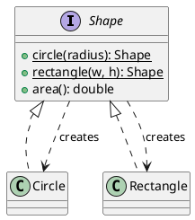

## The limits of a constructor

Consider this line:

```java
Shape shape = new Circle(5);
```

The caller must know the **concrete class** `Circle`. That is fine in a small program, but it causes problems:

- Sometimes the caller **should not** (or cannot) know which concrete class to instantiate. It only wants "a shape".
- Sometimes creating an object needs **logic**: validating arguments, reusing an existing object, or choosing between several subtypes.

A constructor cannot do all of that. It always creates a **new object of exactly its own class**, it cannot return `null` or a cached object, and its name is always the class name.

## What is a factory method?

:::remember
**Factory Method**: a creational pattern that delegates object creation to a method instead of calling a constructor directly, so the caller depends on an **abstraction**, not on a concrete class.
:::

A factory method is a static or instance method that **returns an object**. Compared with `new`, it can:

- hide the concrete class behind an interface or supertype,
- return a **cached** (shared) instance instead of a new one,
- return a **subtype** depending on the arguments,
- have a **meaningful name**, such as `Shape.circle(5)`, instead of the class name.

Validating arguments is common in factory methods, but a constructor can validate just as well, so that is not the difference.

## Implementation

A common place for factory methods is a `static` method of the interface itself:

```java
public interface Shape {
    static Shape circle(double radius) {
        if (radius <= 0) throw new IllegalArgumentException();
        return new Circle(radius);
    }

    static Shape rectangle(double w, double h) {
        return new Rectangle(w, h);
    }

    double area();
}

Shape s = Shape.circle(5);   // the caller never sees Circle
```



The caller works only with the `Shape` interface. Which concrete class is created is the decision of the factory method. Later the code can create a different class (or a cached one) and no caller needs to change. The factory method `circle` also validates the radius in one central place (a constructor could do this too). The real gain is that callers only know `Shape`, never `Circle`.

To make sure that callers really use the factories, the concrete classes `Circle` and `Rectangle` can be package-private, so that code outside the package cannot call their constructors at all.
