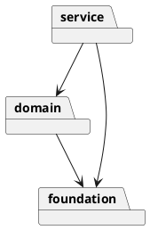

## Why structure at all?

A small program fits into one file. A real program has dozens of classes, and the first question you ask when you open it is: *where is the code that does X?* A clear package structure answers this question before you read a single line.

A simple structure that works for many projects has three packages:

| Package | What lives there | Example |
|---|---|---|
| `domain` | The concepts of the problem, with their rules | `Denomination`, `Envelope`, `CashPayout` |
| `service` | Use cases that orchestrate the domain objects | `CashPayoutService` |
| `foundation` | Small generic helpers that know nothing about the problem | `Ensurer`, `MapOperations` |

The examples in this module come from a kata in which a company works out which banknotes and coins go into each worker's pay envelope. You do not need to know the kata: only the shape of the code matters.



The arrows show who may use whom. They only point **downwards**: `foundation` knows nobody, `domain` knows only `foundation`, and `service` knows both. If `domain` imported something from `service`, you would have a cycle, and you could no longer understand or test one part without the other.

:::remember
Dependencies point in one direction: `service` → `domain` → `foundation`. A helper in `foundation` must never mention a domain class.
:::

## Foundation: small generic helpers

Some code is needed everywhere but is not about your problem: checking arguments, merging maps, formatting. Put it into `foundation`, and make it so general that you could copy the package into the next project without changing a line.

The most common foundation class is a collection of **guard clauses**. A guard clause checks a precondition at the top of a method and fails immediately if it is violated:

```java
public final class Ensurer {

    private Ensurer() { }   // utility class: nobody creates instances

    public static <T> T ensureNotNull(T value) {
        if (value == null) {
            throw new IllegalArgumentException("value must not be null!");
        }
        return value;
    }
}
```

Three details are worth noticing:

- The class is `final` with a `private` constructor and only `static` methods: it is a pure helper, not an object.
- The method **returns** its argument. That lets you check and use a value in one expression, as in `ensurePositive(ensureNotNull(payment))`.
- It is generic (`<T>`), so one method works for every type.

## Fail fast

Without a guard, a `null` travels through your program until some unrelated line throws a `NullPointerException`. The stack trace points to the *victim*, not to the *cause*. With a guard clause, the program stops **at the entry** to the method, with a message that names the problem:

```java
public CashPayout breakDownIntoDenominations(List<Integer> payments) {
    ensureNotNull(payments);                 // guard: fails right here
    return payments.stream() /* ... */;      // the real work
}
```

This idea is called **fail fast**. Guards also keep the main logic free of nesting: instead of wrapping the whole method in `if (payments != null) { ... }`, you reject the bad case first and then continue on one level of indentation.

:::warning
Make a helper do what its name promises for **every** type it accepts. A method `<T extends Number> T ensurePositive(T value)` that only checks `value instanceof Integer` silently lets a negative `Long` or `Double` pass. Either handle all cases, or declare the narrow type: `int ensurePositive(int value)`.
:::

## Another foundation example

Foundation helpers are not only guards. This one merges two `EnumMap`s and combines the values of equal keys with a function you pass in:

```java
public static <K extends Enum<K>, V> EnumMap<K, V> merge(
        EnumMap<K, V> map1, EnumMap<K, V> map2,
        BiFunction<V, V, V> mapping, Class<K> clazz) {
    var newMap = new EnumMap<K, V>(clazz);
    Stream.concat(map1.entrySet().stream(), map2.entrySet().stream())
            .forEach(e -> newMap.merge(e.getKey(), e.getValue(), mapping));
    return newMap;
}
```

It is generic, it knows nothing about banknotes, and it does not change its arguments. That is exactly what belongs in `foundation`.

:::remember
`foundation` holds generic, problem-independent helpers (guard clauses, collection utilities). Guards fail fast with a clear message and return the checked value, so they can be chained.
:::
