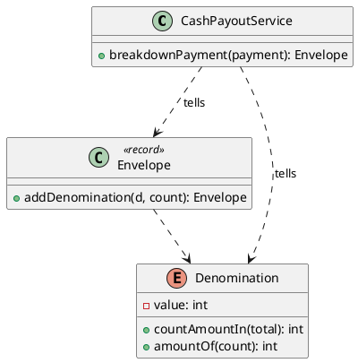

## Domain objects that protect themselves

An object in the `domain` package should never exist in an invalid state. If an `Envelope` with a negative total value is possible, then **every** piece of code that uses an envelope must check for it, and sooner or later someone forgets.

The best place to enforce the rules is the **constructor**. For a `record`, that is the **compact constructor**: it has no parameter list, runs before the fields are assigned, and may throw:

```java
public record Envelope(EnumMap<Denomination, Integer> breakdown, Integer totalValue) {

    public Envelope {                       // compact constructor
        ensureNotNull(breakdown);
        ensurePositive(ensureNotNull(totalValue));
    }
}
```

Now you cannot create an invalid `Envelope`, and every `Envelope` you receive is valid by construction. Note how the guard clauses from the `foundation` package make this a two-liner.

In a compact constructor you may also **replace a parameter** before it is stored, for example with a defensive copy:

```java
public record Playlist(String name, List<String> tracks) {
    public Playlist {
        ensureNotNull(name);
        tracks = List.copyOf(ensureNotNull(tracks));   // unmodifiable copy
    }
}
```

You write `tracks = ...`, not `this.tracks = ...`: the compact constructor assigns the fields for you at the end.

## Immutable: change means "make a new one"

Record fields are `final`, and a record has no setters. To "change" a value you create a modified **copy** and return it. The kata's envelope does this:

```java
public Envelope addDenomination(Denomination denomination, int amount) {
    var newBreakdown = new EnumMap<>(breakdown);          // copy, never modify the old one
    newBreakdown.merge(denomination, amount, Integer::sum);
    return new Envelope(newBreakdown, totalValue + denomination.amountOf(amount));
}
```

The old envelope is untouched, so you can share it freely, use it in streams and `reduce`, and never wonder who modified it.

:::warning
A record is only **shallowly** immutable. `final` protects the *reference*, not the object behind it: a `List` or `EnumMap` component can still be modified by whoever holds another reference. For a truly immutable record, copy collections in the compact constructor (`List.copyOf`, `Map.copyOf`) and never hand out the internal collection for modification. In the code above, the `EnumMap` is a weak spot: the record promises immutability that it does not fully keep.
:::

## Tell, don't ask

Who should know how many `€ 5` notes fit into an amount? The first idea is the service:

```java
// ASK: the service pulls data out and does the work itself
int value = denomination.getValue();
int count = rest / value;
envelope.getBreakdown().put(denomination, count);
envelope.setTotal(envelope.getTotal() + count * value);
```

The service asks for the data (`getValue`, `getBreakdown`, `getTotal`), computes, and pushes the result back in. All the knowledge about "how a denomination works" is in the wrong place, and every other class that needs it has to repeat it.

The principle **tell, don't ask** says: tell the object *what you want*, and let it use its own data to do it.

```java
public enum Denomination {
    EUR_200(200), /* ... */ EUR_1(1);

    private final int value;
    Denomination(int value) { this.value = value; }

    public int countAmountIn(int totalValue) { return totalValue / value; }
    public int amountOf(int count)           { return count * value; }
}
```

```java
// TELL: one expressive line in the service
int count = denomination.countAmountIn(payment - envelope.totalValue());
return envelope.addDenomination(denomination, count);
```

The field `value` is `private` and there is **no getter**. Nobody outside needs the number; they need the *answers*. The logic lives next to the data it works on, so it is written once and can be tested in isolation.



:::remember
Validate in the compact constructor so invalid objects cannot exist. Keep records immutable (return new copies, copy collections). Put behaviour next to the data: instead of asking an object for its fields, tell it what to do.
:::

:::exercise recipe-book
