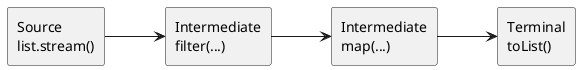

## The problem with loops

Suppose you have a list of numbers and want only the even ones. The classic Java solution is a loop:

```java
List<Integer> even = new ArrayList<>();
for (Integer n : numbers) {
    if (n % 2 == 0) {
        even.add(n);
    }
}
```

Almost every loop has the same shape: create a container, iterate, check a condition, add to the container. The actual idea ("keep the even numbers") is buried in this bookkeeping. And the more you want to do (filter, then transform, then count), the more such loops and temporary variables you need.

## A stream describes the "what"

A **stream** is a sequence of elements that you process step by step. The same task as a stream:

```java
List<Integer> even = numbers.stream()
    .filter(n -> n % 2 == 0)
    .toList();
```

Read it from top to bottom: take the numbers, keep those that are even, make a list. You say **what** you want, not **how** to iterate.

A few facts you should know about streams:

- A stream is **not a data structure**. It does not store elements; it processes the elements of a **source** (a list, a set, an array, ...). The source itself is not changed.
- Operations can be **chained** into a pipeline.
- Streams are **lazy**: the steps do not run until the pipeline is finished by a *terminal* operation (see the next section).
- A stream can be consumed **once**. After a terminal operation it is used up, and you create a new one with `numbers.stream()` if you need it again.

:::remember
The lambda `n -> n % 2 == 0` is a small piece of code that you hand to `filter`: "for each `n`, answer whether it is even". Lambdas get their own module right after this one. For now, read `n -> ...` as "given an `n`, compute ...".
:::

## Source, intermediate, terminal

Every stream pipeline has three parts:



1. The **source** creates the stream, for example `list.stream()`.
2. **Intermediate operations** such as `filter` and `map` each return a new stream, so you can chain as many as you like.
3. Exactly one **terminal operation** such as `toList()`, `count()` or `forEach(...)` ends the pipeline and produces the result.

```java
List<String> result = list.stream()          // source
    .filter(s -> s.startsWith("A"))          // intermediate
    .map(s -> s.toUpperCase())               // intermediate
    .toList();                               // terminal
```

## Lazy evaluation

Intermediate operations only **describe** work. Nothing is computed until a terminal operation asks for the result. You can see this when the lambda prints something:

```java
List<String> names = List.of("Ann", "Berta", "Chris");

var pipeline = names.stream()
    .filter(n -> {
        System.out.println("checking " + n);
        return n.length() > 3;
    });
System.out.println("pipeline built");   // no "checking ..." yet

List<String> longNames = pipeline.toList();   // now the checks run
```

This prints `pipeline built` first and only then `checking Ann`, `checking Berta` and `checking Chris`.

:::warning
A pipeline **without** a terminal operation does nothing at all. If you write `list.stream().filter(...)` and forget `toList()` or another terminal operation, the code compiles, but no element is ever examined.
:::
