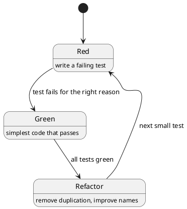

## What is TDD?

**Test-Driven Development** (TDD) is a way of working in which you write the **test before the production code**. You do not write a big feature and test it afterwards. You work in tiny steps, and each step is one pass through a three-phase cycle:

1. **Red**: write one small test for behavior that does not exist yet and watch it fail.
2. **Green**: write the **simplest** code that makes the test pass.
3. **Refactor**: clean up the code (and the tests) without changing behavior. All tests stay green.



One lap takes seconds to a few minutes. If a lap takes half an hour, your step was too big.

## Red: a failing test

Write a test for the next small piece of behavior and **run it**. It must fail. Not compiling yet counts as red too (the class or method does not exist), but the better "red" is a test that compiles and fails with a clear message, because then you know it fails for the right reason.

```java
@Test
void threeIsFizz() {
    assertThat(FizzBuzz.of(3)).isEqualTo("Fizz");
}
```

Why must you see it fail? A test that you have never seen fail may be a test that can **never** fail (a missing assertion, a wrong condition). The red phase proves that the test can detect the missing feature.

## Green: the simplest thing that works

Now write only as much code as you need to turn the bar green. "Simplest" can feel silly:

```java
static String of(int n) {
    return "Fizz";   // passes the test above. Good enough for now.
}
```

You are not cheating. The next test will force you to generalize. The rule protects you from writing code that no test asks for: every line you have in the end exists because a test needed it.

:::warning
The most common mistake is writing too much in the Green phase: the full algorithm, "just in case" parameters, error handling nobody asked for. Whatever no test demands, you do not write yet.
:::

## Refactor: clean up under protection

When the bar is green, you may improve the **structure**: remove duplication, rename, extract a method, replace a magic number by a constant. You must not change **behavior**. The tests tell you immediately if you did: run them after every small change.

This is the real benefit of the tests. You can restructure code fearlessly because you notice a break within seconds. Skipping the Refactor phase is the second classic mistake: the code works, but it slowly turns into a mess, and the next lap gets harder.

:::remember
Red: write a failing test and see it fail. Green: simplest code that passes. Refactor: clean up while everything stays green. Repeat in tiny steps.
:::

## Why work this way?

- You think about **how the code will be used** before you write it, so the test is the first user of your API and shapes the design.
- Every line of production code has a test that demands it.
- You get a safety net for refactoring.
- You spend less time in the debugger: when a test turns red, the last small change is the suspect.

TDD does not mean "more tests". It means that the tests **drive** the design, instead of being added afterwards.
